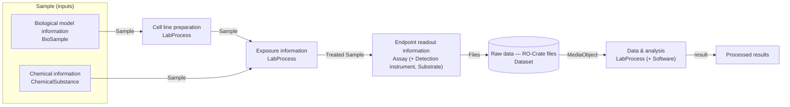

# TEMPLATE.pagetab.json — VHP4Safety BioStudies submission skeleton

Copy this file as `S-VHPSxx.pagetab.json`, replace every value marked `[DRAFT]` with the real content, then delete any subsection you don't need.

## What's in here

Mirrors the structure of S-VHPS21 — the most complete record currently in the collection. Sections appear in the order BioStudies expects:

**Top level**
- `accno` — once issued by BioStudies
- `Template: VHP4Safety` — fixed
- `Title`, `DOI`, `ReleaseDate`, `AttachTo: VHP4Safety`

**`section` attributes (the General + ontology tags)**
- `Title`, `ReleaseDate`, `Description`
- `Organism` (NCBITaxon) — use `NCBITaxon_9606` for human, `NCBITaxon_9615` for dog, `NCBITaxon_10029` for Chinese hamster, etc.
- `Organ`, `Tissue` (UBERON)
- `Case study`, `Regulatory Question`, `Process Flow Step` (VHP4Safety controlled vocab + URLs)
- `License` (`CC-BY` uniformly across the collection)
- `Bioassay` (BAO or OBI term)
- `AOP`, `AOP event` (AOPwiki URLs)

**`section.files`** — point at the RO-Crate zip. The crate goes into the same BioStudies upload.

**`section.links`** — outbound link to the relevant VHP4Safety case study page.

**`section.subsections` (the tabbed content rendered by the platform)**
1. `author` + `organisation` (repeat for each contributor; cross-reference via `affiliation`/`reference: true` to org `accno`)
2. `Funding` — agency + grant ID
3. `Biological model information` — cell line, RRID, supplier, cell type; optional repeatable nested `Cell line preparation` (a Bioschemas *LabProcess*: `Preparation type` = Differentiation / Stable transfection, protocol, reference) and `Donor` blocks
4. `Chemical information` — name, CAS, PubChem CID, CompoundCloudID (repeat per compound)
5. `Exposure information` — shared `Exposure type` / `Exposure-measurement interval` / concentration, plus repeatable nested `Exposure regimen` blocks (each may reference the `Bioassay` it applies to)
6. `Endpoint readout information` — one per `Bioassay`; carries `Bioassay`, `AOP event`, description, replicates, measured entity, readout, with nested `Detection instrument` and an optional `Substrate`. (`Positive control` is an attribute here, not a separate subsection.)
7. `Data & analysis` — provenance of the processed results: `Data availability` / `Accession`, `Analysis code`, `Analysis pipeline`, `Reference genome` (omics), `Statistical method`, `Significance threshold`, plus repeatable nested `Software` (Name + Version + URL). Omit if not applicable.
8. `Publication` — only if there's a linked manuscript; delete otherwise

## Module map — provenance flow (Bioschemas / ISA crosswalk)

The modules are not a flat list; they form one provenance chain — **sample → preparation → assay → raw data → analysis.** This is the contract the eventual RO-Crate / ISA-Tab export follows: each module maps to a Bioschemas type and a role (input / process / output), so conversion is mechanical rather than per-record judgement.

| Module | Bioschemas type | ISA role | input (`object` / `derivesFrom`) | output (`result`) |
|---|---|---|---|---|
| `Biological model information` | `BioSample` | Source / Sample | — | the model used downstream |
| `Cell line preparation` *(nested)* | `LabProcess` (+ `LabProtocol`) | Process | Biological model | prepared / differentiated cells |
| `Chemical information` | `MolecularEntity` | Material | — | dosed agent for Exposure |
| `Exposure information` (+ `Exposure regimen`) | `LabProcess` (+ `LabProtocol`) | Process | prepared cells **+** chemical | treated sample |
| `Endpoint readout information` (+ `Detection instrument`, `Substrate`) | `LabProtocol` → measurement | Assay | treated sample | raw data |
| RO-Crate files (`section.files`) | `Dataset` | Data | — | — |
| `Data & analysis` (+ `Software`) | `LabProcess` / `ComputationalWorkflow` | Process (data transform) | raw data (`Dataset`) | processed results |
| `author` / `organisation` | `Person` / `Organization` | agents | — | — |
| `Funding` | `MonetaryGrant` | — | — | — |
| `Publication` | `ScholarlyArticle` | — | — | — |

Note the **two LabProcesses acting on the sample**: `Cell line preparation` prepares the biological model, `Exposure information` applies the chemical to it. Both are `LabProcess` nodes — one is nested under the model, the other is top-level, but the converter treats them identically.

## Conventions

- **Every value the submitter must fill in is prefixed `[DRAFT]`.** Search-and-replace `[DRAFT]` to verify nothing was missed.
- **Empty attributes have an empty string in `value` rather than being omitted** — keeps the structure stable and obvious to reviewers.
- **`Organism`, `Organ`, `Tissue`, `Bioassay`** must carry ontology term IDs in `valqual`. Don't strip those — without them the FAIR-Interoperability score drops.
- **Use NCBITaxon for every organism entry.** Don't mix in SNOMED — the rest of the collection now uses NCBITaxon uniformly.
- **`Organ` / `Tissue` inherit, so you only enter them once.** Put the study-wide values at the **section level** — they apply to *every* `Biological model information` block by default. Only add an `Organ`/`Tissue` attribute *inside* a cell-line block when **that line differs** (e.g. a multi-model study with brain *and* liver lines, like S-VHPS27: section default Brain, HepG2 block overrides to Liver). The platform renders per-cell-line value if present, else the section-level default — so shared organ/tissue is never re-typed per line.

